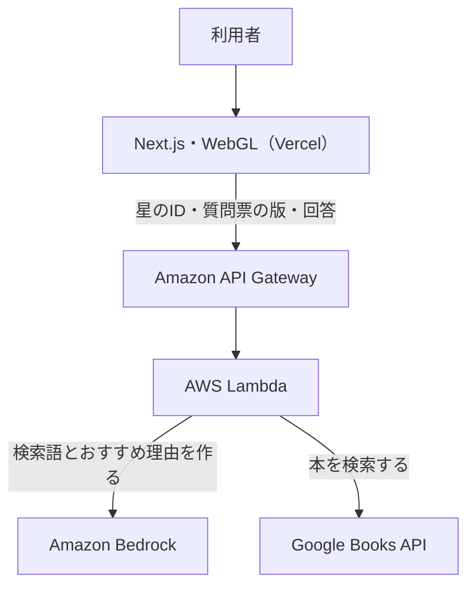

# ほしるべ（HOSHIRUBE）

**本を通して、まだ知らない「好き」に出会う。**

ほしるべは、まだ夢中になれることが見つかっていない人が、本をきっかけに新しい分野を探索するWebアプリです。質問に答えると、気になるかもしれない分野が夜空に星として現れます。星を選ぶと、その分野につながる本に出会えます。本を読むたびに、自分の星座が育っていきます。

## なぜ本なのか

本には、著者がどんな問いを持ち、どんな背景からその考えにたどり着いたのかが、まとまった文脈とともに書かれています。ほしるべは、その文脈までたどりたくなる一冊との出会いをつくり、読んだ先で生まれた興味を次の一冊につなげます。

## 体験の流れ

### 1. 質問に答える

基本は3問です。質問と選択肢のID・文言・選択数は `contracts/questionnaires/onboarding-v1.json` を正本とします。

| 質問 | 聞くこと |
| --- | --- |
| 1問目（`interest`） | いま、どんなことにちょっと興味がある？ |
| 2問目（`themes`） | 気になるテーマをいくつか選んでみてください |
| 3問目（`reading_experience`） | 本を読むとき、どんな体験が好き？ |

1問目で「特にない・なんとなく」を選んだ場合も、2問目に進みます。追加質問に対応する版（`onboarding-v2`）では、その場合だけ「音楽で気分が変わる理由」「宇宙の謎」「街が今の形になった理由」から1〜3個を選ぶ `curiosity` を出します。1問目が「特になし」以外のときは `curiosity` を送りません。既存の3問画面は `onboarding-v1` で接続できます。

### 2. 星空をひらく

回答をもとに、フロントの点数計算（`calcScores`・`tiersFor`）が星の明るさを決めます。AIが星を選ぶのではなく、現在の星空の表示をそのまま活かします。質問を終えた時点で、APIの応答を待たずに星空を表示できます。

### 3. 星を選んで、本に出会う

星を選ぶと、その星のIDと回答をバックエンドへ送り、関連する本を最大5冊受け取ります。各書籍には、回答と書誌情報に基づく個別のおすすめ理由が付きます。理由を作れない場合も本自体は表示し、理由がないことを示します。気になった本はライブラリに保存できます。

### 4. 読んだ先で、星座が育つ

本を読み終えて読了を記録すると、その本に関連する星が灯り、星座が育ちます。灯った星から次の一冊を探せます。

「この本を読んで、もっと知りたくなったことは？」をきっかけに、気になったテーマやメモを任意で残せます。読了後にどの星を結ぶかは、別の画面仕様として決めます。

## アーキテクチャ

| 技術 | 役割 |
| --- | --- |
| Next.js / React / TypeScript | 質問画面、星座図、書籍一覧、ライブラリ |
| WebGL / GLSL | 2Dの星座図を直接描画し、星の光や接続線を表現する |
| CSS / Tailwind CSS | 画面のスタイルとレイアウト |
| Vercel | Webアプリのホスティング |
| Amazon API Gateway | 画面からのリクエストを受け取り、Lambdaに渡す |
| AWS Lambda | 入力の検証、外部サービスへの問い合わせ、応答の整形 |
| Amazon Bedrock | 星と回答から検索語を作り、取得した本の個別のおすすめ理由を作る |
| Google Books API | 関連書籍を検索し、書名・著者・表紙などを取得する |

APIサーバー（API Gateway・Lambda）はまだ実装されていません。図は構成の確定案であり、稼働中のサービスではありません。

## API

### API一覧

| メソッドとパス | 用途 |
| --- | --- |
| `POST /v1/books/recommendations` | 星ID・質問票の版・回答を送り、書籍とおすすめ理由を受け取る |
| `GET /health` | APIの稼働確認。外部サービスは呼ばない |

ログイン・Cookie・ユーザーDBは使いません。回答、保存した本、読了記録はブラウザ内に保存し、APIは回答や推薦結果をDBに保存しません。

### 星を押したら、関連する本を探す

1. 画面が、選んだ星のID（`themeId`）、質問票の版（`questionnaireVersion`）、回答配列（`answers`）を送ります。回答はURLのクエリではなく本文に含めます。
2. Lambdaが本文、星ID、版、回答の整合性を検証します。不正な入力では外部サービスを呼びません。
3. Lambdaが星の基本検索語と回答から検索語を作り、Google Books APIで本を検索します。検索語の生成に失敗した場合は基本検索語に戻します。
4. 取得した本のうち、内容紹介があるものをBedrockに渡し、本ごとのおすすめ理由を作ります。理由の生成に失敗した場合や紹介文がない場合は、その本の理由を `null` にして警告を返します。本自体は返します。
5. 画面は最大5冊を、返された順に表示します。0件の場合は「別の星も探してみよう」と案内します。

### 契約の参照

- 送受信の正本：`docs/openapi.yaml`（OpenAPI 3.0.3）
- 星ID・名称・親子関係・基本検索語：`contracts/themes.json`
- 質問・選択肢・選択数・分岐条件：`contracts/questionnaires/`
- 意味上の制約と処理：`docs/superpowers/specs/2026-11-16-backend-api-design.md`
- ローカルSwagger UI：`npm --prefix docs ci` の後、`npm --prefix docs run serve` を実行し、`http://127.0.0.1:8080/` を開く

Swagger UIはローカルのアセットだけを使い、Try it outは無効です。OpenAPIのサーバーURL `https://api.example.invalid` は未デプロイを示すプレースホルダーで、実在しません。

## MVPで見せる体験

1. 最初の質問で「特にない・なんとなく」を選び、その後の質問に答える。
2. 星空がひらき、星を押すと関連書籍が表示される。
3. 読み終えた本の読了を記録する。
4. その本に関連する星が灯り、星座が育つ。

## 決まっていること

- 星の決定と明るさは、フロントの点数方式を維持する。AIによる星の選定はMVPでは行わない。
- 業務APIは `POST /v1/books/recommendations` の1本。書籍は最大5冊。
- 質問票は `onboarding-v1` と `onboarding-v2` を受理する。v2の追加質問は `interest=none` のときだけ必須。
- おすすめ理由は書籍の内容紹介を根拠に生成する。根拠不足や生成失敗では理由を `null` にし、本は返す。
- 回答・保存した本・読了記録はブラウザ内に保存する。

## 残る検討

- 読了時にどの星を結ぶか、星座の成長ルール。
- 追加質問の画面文言の調整（IDと意味は変えない）。
- 書籍カードで内容紹介を開く位置など、表示の詳細。
- AWSのリージョン、Bedrockのモデル、IaC、運用値などの実装設定。

## 参考資料

- [Amazon Bedrock Converse API](https://docs.aws.amazon.com/bedrock/latest/userguide/conversation-inference.html)
- [Google Books APIs](https://developers.google.com/books/docs/v1/using)
- [WebGL API（MDN）](https://developer.mozilla.org/ja/docs/Web/API/WebGL_API)
