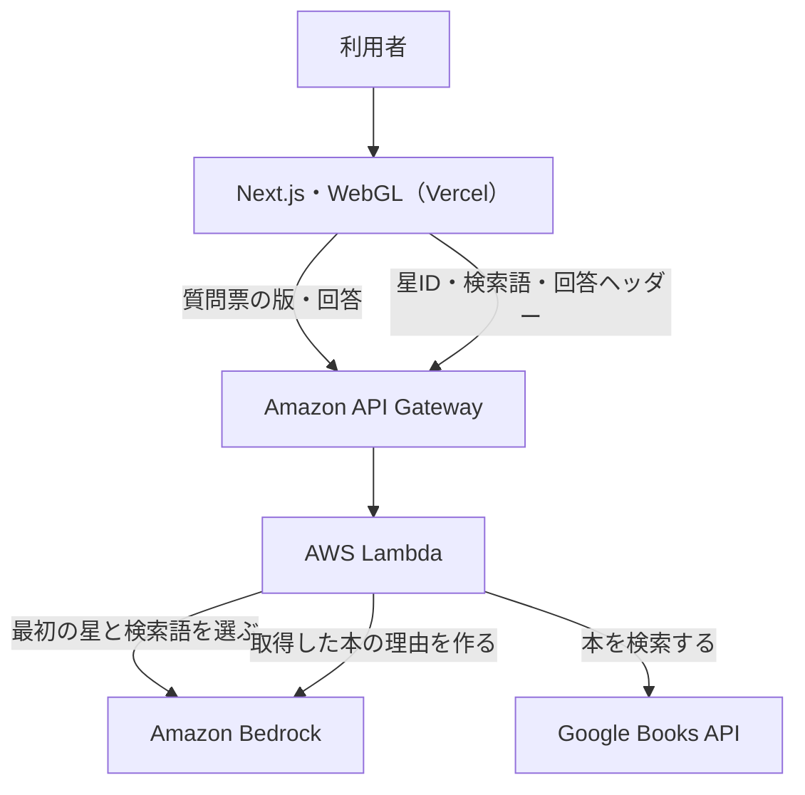

# ほしるべ（HOSHIRUBE）

**本を通して、まだ知らない「好き」に出会う。**

ほしるべは、まだ夢中になれることが見つかっていない人が、本をきっかけに新しい分野を探索するWebアプリです。質問に答えると、気になるかもしれない分野が夜空に星として現れます。星を選ぶと、その分野につながる本に出会えます。本を読むたびに、自分の星座が育ちます。

## なぜ本なのか

本には、著者がどんな問いを持ち、どんな背景からその考えにたどり着いたのかが、まとまった文脈とともに書かれています。ほしるべは、その文脈までたどりたくなる一冊との出会いをつくり、読んだ先で生まれた興味を次の一冊につなげます。

## 体験の流れ

### 1. 質問に答える

API契約の基本は3問です。質問と選択肢のID・文言・選択数は `contracts/questionnaires/onboarding-v1.json` を正本とします。

| 質問 | 聞くこと |
| --- | --- |
| 1問目（`interest`） | いま、どんなことにちょっと興味がある？ |
| 2問目（`themes`） | 気になるテーマをいくつか選んでみてください |
| 3問目（`reading_experience`） | 本を読むとき、どんな体験が好き？ |

`onboarding-v2` では、1問目で「特にない・なんとなく」を選んだ場合だけ、「音楽で気分が変わる理由」「宇宙の謎」「街が今の形になった理由」から1〜3個を選ぶ `curiosity` を追加します。1問目が「特になし」以外のときは `curiosity` を送りません。

フロントエンドにはAPIクライアントを組み込み済みです。`NEXT_PUBLIC_API_BASE_URL` が未設定ならローカルデモとして点数計算と固定書籍データを使い、設定されている場合はseedと書籍APIを呼びます。API接続中の失敗は画面に表示し、ローカルデータへ黙って切り替えません。契約だけで動作するローカルモックとk6シナリオは `docs/mock-api-k6.md` を参照してください。

### 2. 星空をひらく

回答を送ると、APIがAmazon Bedrockで回答を解釈し、星カタログの大ジャンルから異なる3つと、星ごとの書籍検索語を選びます。返された配列はおすすめ順で、先頭の星を初期選択として画面に表示します。星の座標・色・明るさ・配置・描画はフロントの担当です。

初期に選ぶ星は、このseedの結果を正とします。2026-11-16の仕様ではフロントの固定点数（`calcScores`・`tiersFor`）で星を選ぶとしていましたが、その判断は取り消しました。AIによる星選出をフロントの点数計算で置き換えず、APIの選出結果を描画します。回答を送ってから星が現れるため、画面はseedの完了を待ちます。失敗した場合は点数方式へ黙って切り替えず、再試行を案内します。

たとえば元の企画では「音で気分が変わる理由」を選んだ人に「心理学」の星を見せる例を挙げていました。これは体験の説明例で、現在の星IDの正本は `contracts/themes.json` の15ID（大ジャンル9・中ジャンル6）です。新しい星を勝手に追加しません。

### 3. 星を選んで、本に出会う

星を選ぶと、その星のID（`themeId`）、seedで受け取った検索語（`q`）、質問票の版と回答（`X-Discovery-Context` ヘッダー）をバックエンドへ送り、関連する本を最大5冊受け取ります。各書籍には、回答と書誌情報に基づく個別のおすすめ理由が付きます。理由を作れない場合も本自体は表示し、理由がないことを示します。気になった本はライブラリに保存できます。

`X-Discovery-Context` は `JSON.stringify({ questionnaireVersion, answers })` で作る、ASCIIの既知IDだけのJSON文字列です。認証トークンでも、seedを呼んだ事実の証明でもありません。回答全文をURLやログへ載せず、毎回同じ回答条件で検証します。

### 4. 読んだ先で、星座が育つ

本を読み終えて読了を記録すると、その本に関連する星が灯り、星座が育ちます。灯った星から次の一冊を探せます。

「この本を読んで、もっと知りたくなったことは？」をきっかけに、気になったテーマやメモを任意で残せます。読了後にどの星を結ぶかは、別の画面仕様として決めます。

## アーキテクチャ



| 技術 | 役割 |
| --- | --- |
| Next.js / React / TypeScript | 質問画面、星座図、書籍一覧、ライブラリ |
| WebGL / GLSL | 2Dの星座図を直接描画し、星の光や接続線を表現する |
| CSS / Tailwind CSS | 画面のスタイルとレイアウト |
| Vercel | Webアプリのホスティング |
| Amazon API Gateway | 画面からのリクエストを受け取り、Lambdaに渡す |
| AWS Lambda | 入力の検証、外部サービスへの問い合わせ、応答の整形 |
| Amazon Bedrock | 回答から最初の星と検索語を選び、取得した本の個別のおすすめ理由を作る |
| Google Books API | 検索語で関連書籍を検索し、書名・著者・表紙などを取得する |

AWSのAPIサーバー（API Gateway・Lambda）とAWSリソースはまだ実装されていません。図は構成の確定案であり、稼働中のサービスではありません。ローカルの契約モックはフロント接続と負荷試験用で、Google BooksやBedrockへ接続せず、実際の推薦品質やAWSの性能を再現しません。

## API

### API一覧

| メソッドとパス | 用途 |
| --- | --- |
| `POST /v1/discovery/seed` | 質問票の版と回答を送り、最初に表示する星と星ごとの検索語を受け取る |
| `GET /v1/themes/{themeId}/books` | 選んだ星・検索語・回答を送り、書籍とおすすめ理由を受け取る |
| `GET /health` | APIの稼働確認。外部サービスは呼ばない |

ログイン・Cookie・ユーザーDBは使いません。回答、保存した本、読了記録、seedの結果はブラウザ内に保存し、APIは回答や推薦結果をDBに保存しません。

### 質問に答えたら、最初に見せる星を決める

1. 画面が質問票の版（`questionnaireVersion`）と回答配列（`answers`）をまとめて送ります。「特にない・なんとなく」も回答として含めます。星IDは送りません。
2. Lambdaが本文の型・必須・版ごとの回答条件を検証します。不正な入力では外部サービスを呼びません。
3. LambdaがBedrockに回答を渡し、星カタログの大ジャンル9IDから異なる3個と、各星の書籍検索語を1回で選びます。
4. Lambdaが結果を検証します。未定義ID・重複ID・不正な検索語・不正な件数は画面へ流さず `502` にします。AIの停止やスロットリングは `503`、タイムアウトは `504` です。フロントの点数方式への隠れたfallbackは行いません。
5. 画面はseedの完了を待って星を表示し、回答とseedの結果をブラウザに保存します。配列の先頭の星を初期選択にし、各星はseedの検索語を保持します。星の名称・座標などは共有カタログとフロントで解決します。

成功すると、たとえば次の結果が返ります（架空の例）。

```json
{
  "requestId": "example-seed-001",
  "themes": [
    { "themeId": "tec", "searchQuery": "プログラミング ものづくり 入門" },
    { "themeId": "mon", "searchQuery": "デザイン 発想 入門" },
    { "themeId": "phi", "searchQuery": "哲学 新しい視点 入門" }
  ]
}
```

### 星を押したら、関連する本を探す

1. 画面が、押された星のID（`themeId`）、seedで受け取った検索語（`q`）、回答（`X-Discovery-Context` ヘッダー）を送ります。`GET` のため本文は使いません。回答はURLのクエリにも載せません。
2. LambdaがID・検索語・ヘッダーの回答を、共有カタログと同じ回答条件で検証します。不正な入力では外部サービスを呼びません。
3. Lambdaが検索語でGoogle Books APIを検索します。検索語のAI生成はseedで済ませており、ここでは再生成しません。seedに含まれない子ジャンルなどを探索するときは、カタログの基本検索語を `q` に指定できます。
4. 取得した本のうち、内容紹介があるものをBedrockに渡し、本ごとのおすすめ理由を作ります。理由の生成に失敗した場合や紹介文がない場合は、その本の理由を `null` にして警告を返します。本自体は `200` で返します。
5. 画面は最大5冊を、返された順に表示します。0件の場合は「別の星も探してみよう」と案内します。

### 実装時のパスと補足

| メソッドとパス | 用途 |
| --- | --- |
| `POST /v1/discovery/seed` | 回答をまとめて送り、最初に表示する星と星ごとの検索語を受け取る |
| `GET /v1/themes/{themeId}/books?q=...` | 選んだ星の関連書籍を取得する |

`themeId` は「哲学」なら `phi` のように、どの星を押したかを識別する値です。`q` は `URLSearchParams` でエンコードして送ります。書籍一覧に含まれない詳細が必要になった場合は、書籍詳細を取得するAPIを追加します。

以前の契約にあった `POST /v1/books/recommendations` は、この2本の業務APIへ置き換えて廃止しました。互換aliasは用意しません。

### 契約の参照

- 送受信の正本：`docs/swagger-ui/openapi.yaml`（OpenAPI 3.0.3、API契約 `info.version` は `2.0.0`）
- 星ID・名称・親子関係・基本検索語：`contracts/themes.json`
- 質問・選択肢・選択数・分岐条件：`contracts/questionnaires/`
- 意味上の制約と処理：`docs/backend-api.md`
- ローカルSwagger UI：`npm --prefix docs/swagger-ui ci --ignore-scripts` の後、`npm --prefix docs/swagger-ui run serve` を実行し、`http://127.0.0.1:8080/` を開く

URLの `/v1` はAPIの版、質問票の `onboarding-v1`・`onboarding-v2` は質問票の版で、互いに独立です。元の企画のURL `/v1` を維持しています。

Swagger UIはローカルのアセットだけを使い、Try it outは無効です。OpenAPIのサーバーURL `https://api.example.invalid` は未デプロイを示すプレースホルダーで、実在しません。

## MVPで見せる体験

1. 最初の質問で「特にない・なんとなく」を選び、その後の質問に答える。
2. 星空がひらき、星を押すと関連書籍が表示される。
3. 読み終えた本の読了を記録する。
4. その本に関連する星が灯り、星座が育つ。

## 決まっていること

- 初期に選ぶ星は、Bedrockが回答から選ぶseedの結果を正とする。配列はおすすめ順で、異なる大ジャンル3個を返し、先頭を初期選択にする。フロントは星の配置・色・描画を担当する。
- 業務APIは `POST /v1/discovery/seed` と `GET /v1/themes/{themeId}/books` の2本。旧 `POST /v1/books/recommendations` は廃止済み。書籍は最大5冊。
- 質問票は `onboarding-v1` と `onboarding-v2` を受理する。v2の追加質問は `interest=none` のときだけ必須。
- `GET` の回答は必須の `X-Discovery-Context` ヘッダーへ `JSON.stringify({ questionnaireVersion, answers })` として送る。認証・セッションではなく、CORSの許可ヘッダーに含める。
- おすすめ理由は書籍の内容紹介を根拠に生成する。根拠不足や生成失敗では理由を `null` にし、本は返す。
- 回答・seedの結果・保存した本・読了記録はブラウザ内に保存する。
- APIサーバー（API Gateway・Lambda）は未実装で、OpenAPIの接続先はプレースホルダー。

## 残る検討

- 読了時にどの星を結ぶか、星座の成長ルール。
- 追加質問の画面文言の調整（IDと意味は変えない）。
- 書籍カードで内容紹介を開く位置など、表示の詳細。
- AWSのリージョン、Bedrockのモデル、IaC、運用値などの実装設定。

## 参考資料

- [Amazon Bedrock Converse API](https://docs.aws.amazon.com/bedrock/latest/userguide/conversation-inference.html)
- [Google Books APIs](https://developers.google.com/books/docs/v1/using)
- [WebGL API（MDN）](https://developer.mozilla.org/ja/docs/Web/API/WebGL_API)
