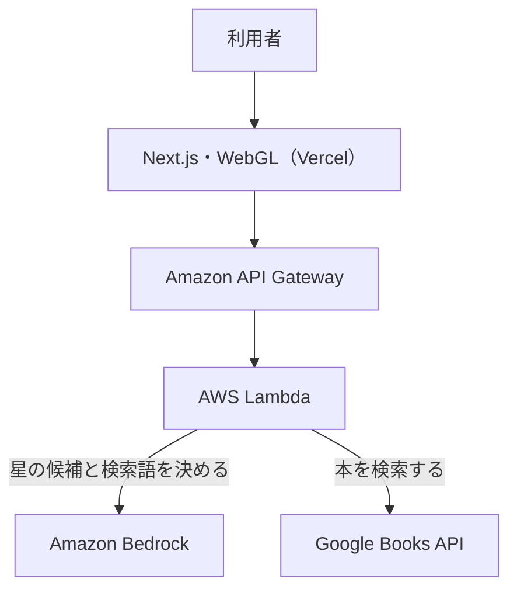

# ほしるべ（HOSHIRUBE）

**本を通して、まだ知らない「好き」に出会う。**

ほしるべは、まだ夢中になれることが見つかっていない人が、本をきっかけに新しい分野を探索するWebアプリです。質問に答えると、気になるかもしれない分野が夜空に星として現れます。星を選ぶと、その分野につながる本に出会えます。読んで気になったことを残すたびに、自分の星座が育っていきます。

## なぜ本なのか

本には、著者がどんな問いを持ち、どんな背景からその考えにたどり着いたのかが、まとまった文脈とともに書かれています。ほしるべは、その文脈までたどりたくなる一冊との出会いをつくり、読んだ先で生まれた興味を次の一冊につなげます。

## 体験の流れ

### 1. 質問に答える

質問数は未定です。以下は画面モックの3問構成をもとにした例です。

| 質問 | 聞くこと |
| --- | --- |
| 1問目 | いま、どんなことにちょっと興味がある？ |
| 2問目 | 気になるテーマをいくつか選んでみてください |
| 3問目 | 本を通して、どんな体験をしてみたい？ |

1問目で「特にない・なんとなく」を選んだ場合も、2問目に進みます。その場合は「音で気分が変わる理由」「街が今の形になった理由」のように、その場で気になったものを選べる具体的な話題を出す案です。

### 2. 星空をひらく

回答を送ると、回答に関連する分野が星として現れます。たとえば「音で気分が変わる理由」を選んだ人には、「心理学」の星を見せます。

### 3. 星を選んで、本に出会う

星を選ぶと、その分野につながる本が表示されます。書名・著者・表紙を見て、気になった本をライブラリに保存できます。

### 4. 読んだ先で、星座が育つ

本を読み終えたら読了を記録します。「この本を読んで、もっと知りたくなったことは？」をきっかけに、気になったテーマを選び、任意でメモを残せます。

選んだテーマの星が灯ります。1冊から複数のテーマに出会った場合は、その星同士を線で結ぶ案です。灯った星から次の一冊を探せます。

## アーキテクチャ

| 技術 | 役割 |
| --- | --- |
| Next.js / React / TypeScript | 質問画面、星座図、書籍一覧、ライブラリ |
| WebGL / GLSL | 2Dの星座図を直接描画し、星の光や接続線を表現する |
| CSS / Tailwind CSS | 画面のスタイルとレイアウト |
| Vercel | Webアプリのホスティング |
| Amazon API Gateway | 画面からのリクエストを受け取り、Lambdaに渡す |
| AWS Lambda | リクエストに応じて外部サービスを呼び、結果を画面に返す |
| Amazon Bedrock | 質問への回答から、最初に見せる星と書籍検索キーワードを選ぶ |
| Google Books API | 関連書籍を検索し、書名・著者・表紙などを取得する |

## APIの流れ

| 画面での操作 | 画面から送るもの | 画面に返るもの |
| --- | --- | --- |
| 質問に答えて「星座をつくる」を押す | 回答をまとめて送る（POST） | 最初に見せる星と、星ごとの書籍検索キーワード |
| 「心理学」などの星を押す | 選んだ星と、その星の検索キーワード（GET） | 関連書籍の一覧 |

### 質問に答えたら、最初に見せる星を決める

1. 画面が回答をまとめて送ります。「特にない・なんとなく」も回答として含めます。
2. API Gatewayがリクエストを受け取ってLambdaに渡します。
3. LambdaがBedrockに回答を渡します。Bedrockで呼び出したAIモデルは、アプリが用意したテーマの中から候補を選び、本を探すためのキーワードを返します。
4. Lambdaが結果を確認して画面に返します。画面はテーマを星として表示し、検索キーワードをその星と一緒に持っておきます。

「音で気分が変わる理由」を選んだ場合、たとえば「心理学」の星と、書籍検索キーワード「音楽 心理 感情」が返ります。

### 星を押したら、関連する本を探す

1. 画面が、押された星と検索キーワードを送ります。
2. LambdaがそのキーワードでGoogle Books APIを検索します。
3. Lambdaが、見つかった本の書名・著者・表紙などを画面に返します。

### 実装時のパス案

| メソッドとパス | 用途 |
| --- | --- |
| `POST /v1/discovery/seed` | 回答をまとめて送り、最初に表示する星を受け取る |
| `GET /v1/themes/{themeId}/books` | 選んだ星の関連書籍を取得する |

`themeId` は「心理学」なら `psychology` のように、どの星を押したかを識別する値です。検索キーワードは `q` という名前で送ります。書籍一覧に含まれない詳細が必要になった場合は、書籍詳細を取得するAPIを追加します。

## MVPで見せる体験

1. 最初の質問で「特にない・なんとなく」を選び、その後の質問に答える。
2. 星空がひらき、星を押すと関連書籍が表示される。
3. 読み終えた本を登録し、その本から気になったテーマを選ぶ。
4. 選んだ星が灯り、複数のテーマを選んだ場合は星が線でつながる。

## チームで決めること

- **質問の数と内容** — 質問をいくつにするか。「特にない・なんとなく」を選んだ人に、次の質問でどんな話題を出すか。
- **星空の表示** — 最初に星をいくつ見せるか。読んだあと、どんなときに星をつなぐか。
- **書籍の表示** — 書名・著者・表紙に加えて、どんな情報を見せるか。
- **読書記録の保存** — MVPでは、保存した本・読書状態・気になったテーマ・任意のメモをブラウザ内に保存する案。

## 参考資料

- [Amazon Bedrock Converse API](https://docs.aws.amazon.com/bedrock/latest/userguide/conversation-inference.html)
- [Google Books APIs](https://developers.google.com/books/docs/v1/using)
- [WebGL API（MDN）](https://developer.mozilla.org/ja/docs/Web/API/WebGL_API)
